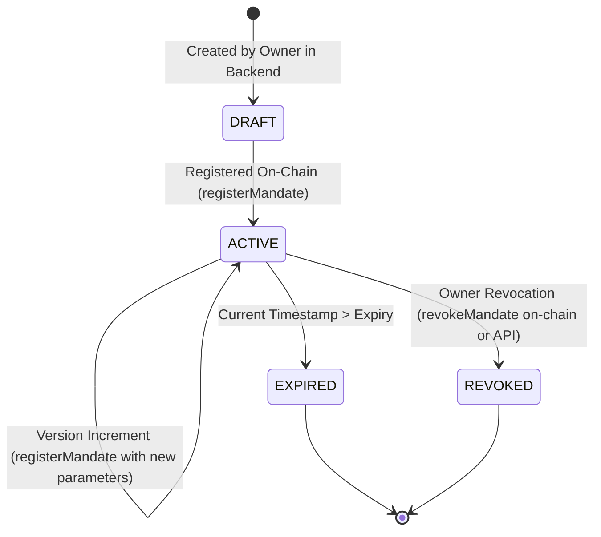
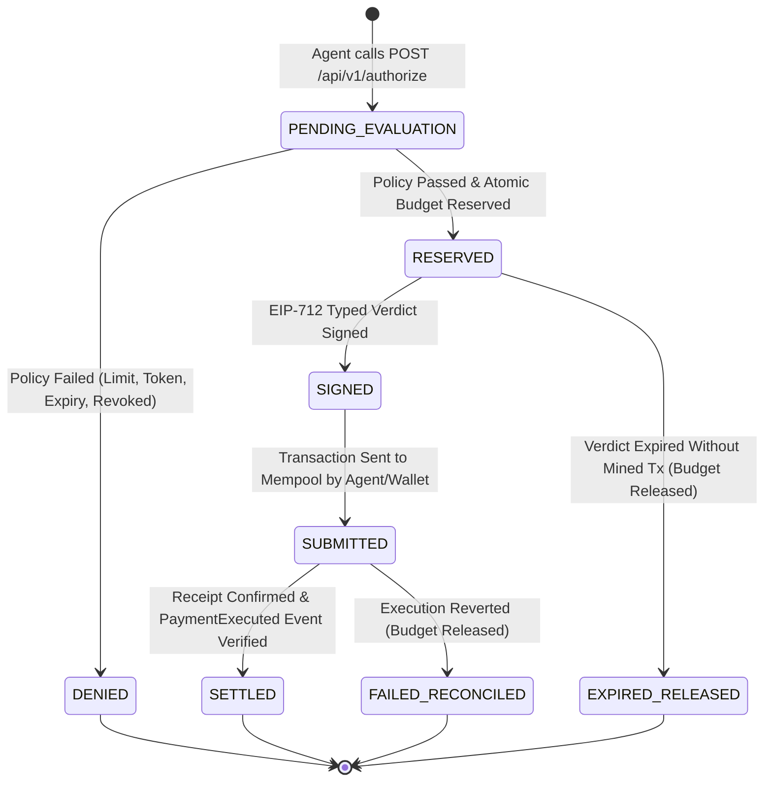

# MandateGuard: Data Flow & Lifecycle State Machine

**Version**: 1.0  
**Classification**: System Architecture Specification  

---

## 1. Overview

MandateGuard coordinates two primary state machines:
1. **Mandate Lifecycle**: Defined by the human owner's policy parameters, versions, and revocation state.
2. **Payment Request Lifecycle**: Governs the progression of an individual payment from evaluation and budget reservation to on-chain execution and settlement.

---

## 2. Mandate Lifecycle State Machine

### Mandate States & Transitions

| State | Allowed Transitions | Transition Trigger | Verification Enforcement |
| :--- | :--- | :--- | :--- |
| **DRAFT** | `ACTIVE`, `CANCELLED` | Mandate saved off-chain | Exists in database; cannot authorize until on-chain registration |
| **ACTIVE** | `ACTIVE` (v+1), `REVOKED`, `EXPIRED` | On-chain `registerMandate` transaction mined | Validated by smart account `mandates[mandateId].isRegistered == true` and `revoked == false` |
| **REVOKED** | None (terminal) | `revokeMandate` called on smart account or API | On-chain contract reverts with `MandateRevokedError` |
| **EXPIRED** | None (terminal) | `block.timestamp > expiry` | Smart account reverts with `MandateNotActive` |

---

## 3. Payment Request Lifecycle State Machine

### Detailed Transition Stages

1. **Request Creation (`POST /api/v1/authorize`)**:
   - The AI agent provides `mandate_id`, `recipient`, `token`, `amount`, `chain_id`, and `idempotency_key`.
   - The API verifies agent identity via `X-API-Key`.

2. **Policy Evaluation & Idempotency**:
   - If `idempotency_key` was previously processed, return the cached verdict.
   - Mandate status, token whitelist, recipient whitelist, time window, and per-tx limits are validated.

3. **Atomic Spending Reservation (`RESERVED`)**:
   - An atomic SQL statement updates `reserved_amount` only if `(max_cumulative_amount - current_spent - reserved_amount) >= amount`.
   - Prevents concurrent requests from overspending the cumulative limit.

4. **Verdict Signing (`SIGNED`)**:
   - EIP-712 structured message is generated and signed with the platform authorizer key.
   - Return signed ALLOW verdict with unique `authorization_id`.

5. **On-Chain Execution (`SUBMITTED`)**:
   - Agent or wallet submits `executePayment(verdict, signature)` to `MandateGuardAccount`.
   - Smart account verifies EIP-712 domain, signature, replay protection, and on-chain mandate registration.
   - Emits `PaymentExecuted` event and transfers ERC-20 tokens via `SafeERC20`.

6. **Settlement & Receipt Reconciliation (`SETTLED`)**:
   - Client calls `POST /api/v1/settle` with `authorization_id` and `tx_hash`.
   - Backend queries RPC provider for `eth_getTransactionReceipt(tx_hash)`.
   - Receipt status is confirmed (`status == 1`).
   - `PaymentExecuted` event is parsed to verify `authorizationId`, `amount`, and `recipient`.
   - Database moves `amount` from `reserved_amount` to `current_spent` and records `SETTLED`.

7. **Failure Reconciliation & Expiration (`EXPIRED_RELEASED`)**:
   - If execution fails, transaction reverts, or authorization expires, `reserved_amount` is decremented to restore available budget.
