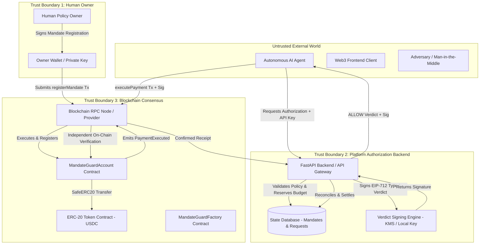

# MandateGuard: Security & Trust Model

**Version**: 1.0  
**Status**: Production Specification  
**Classification**: Engineering & Security Architecture  

---

## 1. System Classification & Decentralization Scope

MandateGuard is a **hybrid decentralized-centralized** payment authorization architecture:
- **Decentralized Layer**: Non-custodial smart accounts (`MandateGuardAccount`), factory registries (`MandateGuardFactory`), cryptographic signature verification (EIP-712), on-chain spending limits, and token transfer settlements.
- **Centralized Layer**: The off-chain authorization service (FastAPI), policy evaluation engine, application database (SQLite / PostgreSQL), and verdict signing key (Local KMS / HSM).

> [!IMPORTANT]
> MandateGuard is **NOT** a fully decentralized system. The verdict-signing authority represents a centralized component that evaluates off-chain context, agent identities, and policy state before issuing an EIP-712 signature. The smart account guarantees that **even if the off-chain system attempts to issue an unauthorized signature, the contract independently enforces registered on-chain boundaries**.

---

## 2. Trust Boundaries & Actor Analysis

### 2.1 The Human Policy Owner
- **Trust Level**: Highest authority for their smart account.
- **Authority**:
  - Deploys the isolated `MandateGuardAccount`.
  - Registers, updates, and revokes mandates directly on-chain via `registerMandate` and `revokeMandate`.
  - Holds emergency withdrawal rights (`emergencyWithdrawToken`) to recover mis-sent assets.
  - Can rotate the authorized `authorizerSigner` key or transfer account ownership.
- **Failure Modes / Compromise**: If the owner's private key is compromised, an attacker can revoke mandates, change the signer, or execute emergency token withdrawals.

### 2.2 The Autonomous AI Agent
- **Trust Level**: Untrusted untrusted caller.
- **Authority**:
  - Possesses an API key for request authentication.
  - May submit payment authorization requests to the backend.
  - May relay signed ALLOW verdicts to the smart account on-chain.
- **Guarantees**:
  - The AI agent never holds smart account funds.
  - The AI agent cannot initiate arbitrary contract calls.
  - The AI agent cannot transfer more than `maxAmountPerTx` or exceed `maxCumulativeAmount`.
  - The AI agent cannot redirect funds to an unapproved recipient.

### 2.3 The Web3 Frontend
- **Trust Level**: Untrusted presentation tier.
- **Constraint**: **No security controls are implemented only in the frontend**. All policy validations, limits, balance checks, and signature verifications occur on the backend and in smart contracts.

### 2.4 The Platform Authorization Backend & Database
- **Trust Level**: Semi-trusted off-chain service.
- **Responsibilities**:
  - Authenticates agents via hashed API keys (`X-API-Key`).
  - Evaluates policy constraints before requesting a cryptographic signature.
  - Performs atomic budget reservation to prevent TOCTOU race conditions.
  - Reconciles mined on-chain transactions against receipts and events.
- **Defense-in-Depth**: A compromised database **cannot** drain funds on-chain because the smart account independently verifies that:
  1. The mandate is registered on-chain by the human owner.
  2. The transfer amount does not exceed `maxAmountPerTx`.
  3. Cumulative spending does not exceed `maxCumulativeAmount`.
  4. The recipient and token match the on-chain registered mandate.
  5. The mandate has not been revoked on-chain.

### 2.5 The Verdict-Signing Service
- **Trust Level**: Critical cryptographic service.
- **Responsibilities**:
  - Signs only verified ALLOW verdicts with the platform authorizer key.
  - Uses strictly defined EIP-712 domain separation (`verifyingContract == account`, `chainId == block.chainid`).
  - Produces 65-byte ECDSA signatures over `PaymentVerdict` typed data.
- **Residual Trust**: The smart account trusts the authorizer signature to attest that off-chain policy conditions (such as human approvals, agent identity, and time-of-request checks) were satisfied.

### 2.6 The Smart Account Contract (`MandateGuardAccount`)
- **Trust Level**: Trustless, deterministic, on-chain enforcement point.
- **Responsibilities**:
  - Independent verification of EIP-712 domain and signature.
  - Replay defense via `usedAuthorizations[authorizationId]`.
  - On-chain enforcement of registered mandate constraints.
  - Token transfer execution via OpenZeppelin `SafeERC20`.
  - Reentrancy protection via `ReentrancyGuard`.

### 2.7 The Blockchain RPC Provider
- **Trust Level**: Infrastructure provider (assumed Byzantine or potentially unreliable).
- **Residual Risks**:
  - Node lag, timeouts, transaction dropped from mempool, chain reorganizations.
  - Backend must handle ambiguous timeouts by verifying receipts against chain state, never assuming success or releasing reservations prematurely.

---

## 3. Residual Trust Matrix

| Component | Residual Trust | Failure Mode | Mitigation / Defense-in-Depth |
| :--- | :--- | :--- | :--- |
| **Authorizer Key** | Trusted to sign only valid verdicts | Key compromise allows signing arbitrary verdicts | On-chain contract still enforces `maxAmountPerTx`, `maxCumulativeAmount`, `recipient`, and `token` bounds from registered mandates. |
| **Owner Key** | Trusted with full control over account | Owner key compromise exposes smart account funds | Smart account emergency escape hatch is owner-only; cold storage recommended for owner wallet. |
| **Backend Database** | Trusted for temporary budget reservation | Data loss or corruption in database | Smart contract maintains immutable on-chain cumulative spent counter and revocation state. |
| **RPC Provider** | Trusted to relay honest chain data | RPC censorship, stale blocks, or downtime | Configurable multi-RPC fallback, receipt polling with confirmation depth. |
| **ERC-20 Token** | Trusted to conform to ERC-20 standard | Malicious fee-on-transfer or reentrant tokens | OpenZeppelin `SafeERC20` wrapper and explicit contract whitelisting. |
