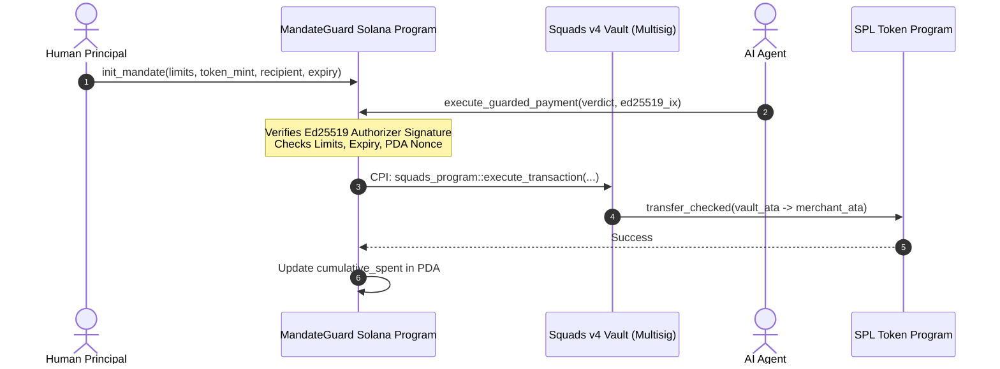

# MandateGuard — Solana & Squads Comparative Security Architecture

## Critical Audit Disclaimer (Requirement 10)

> **Mandatory Security Rule**: An EVM smart contract (e.g., `MandateGuardAccount.sol`) cannot protect Solana assets. Solana uses a completely distinct cryptographic primitives suite (Ed25519 vs. Secp256k1), account model (Account/PDA state separation vs. EVM storage slots), and execution runtime (eBPF vs. EVM). 
> 
> The active production code of MandateGuard protects EVM chains (Base, Ethereum, Arbitrum, Polygon). This document specifies the verified architectural design and prototype requirements for extending MandateGuard to Solana and Squads v4.

---

## 1. Architectural Comparison: EVM vs. Solana

| Dimension | MandateGuard EVM (Implemented) | MandateGuard Solana (Design & Prototype) |
|---|---|---|
| **Language & Framework** | Solidity 0.8.20+, Foundry | Rust, Anchor Framework |
| **Cryptography** | Secp256k1, keccak256, EIP-712 typed hashing | Ed25519, SHA-512, Borsh serialized instruction data |
| **Verification Boundary** | Contract function `executePayment(...)` | Anchor Instruction `execute_guarded_payment` |
| **State Storage** | `mapping(bytes32 => Mandate)` in contract storage | Program Derived Addresses (PDAs) derived from `[b"mandate", owner_pubkey, mandate_id]` |
| **Signature Checking** | `SignatureChecker.isValidSignatureNow` (EIP-1271/ECDSA) | Native `Ed25519Program` instruction introspection (`sysvar::instructions`) |
| **Multisig / Smart Wallet** | Custom Smart Account / Safe module / ERC-4337 | **Squads Protocol v4** (`SQDS4ep65T869zMMBKyuUq6aD6EgTu8psMjkvj52pCf`) |
| **Token Standard** | ERC-20 (`IERC20.safeTransfer`) | SPL Token & Token-2022 (`spl_token::instruction::transfer_checked`) |
| **Replay Protection** | `mapping(bytes32 => bool) public usedAuthorizationIds` | PDA account initialization constraint `init` with unique seed or bitfield bitmap |

---

## 2. Solana Account Architecture & PDAs

In Solana, programs are stateless code. All state resides in separate accounts. To replicate MandateGuard on Solana:

### Mandate Account PDA
```rust
#[account]
pub struct SpendingMandate {
    pub owner: Pubkey,                // Human principal who approved the mandate
    pub mandate_id: [u8; 32],         // Unique identifier
    pub token_mint: Pubkey,           // SPL Token mint (e.g. USDC)
    pub recipient: Pubkey,            // Allowed merchant/recipient
    pub max_per_tx_amount: u64,       // In token base units
    pub max_cumulative_amount: u64,   // Total spend ceiling
    pub cumulative_spent: u64,        // Accumulated spent amount
    pub expiry: i64,                  // Unix timestamp
    pub is_revoked: bool,             // Revocation flag
    pub bump: u8,
}
```
Seeds: `[b"mandate", owner.key().as_ref(), mandate_id.as_ref()]`

### Authorization Record PDA (Replay Prevention)
To prevent replaying an authorized verdict:
```rust
#[account]
pub struct AuthorizationReceipt {
    pub authorization_id: [u8; 32],
    pub executed_at: i64,
}
```
Seeds: `[b"receipt", mandate.key().as_ref(), authorization_id.as_ref()]`
When `execute_guarded_payment` runs, it uses Anchor's `init` constraint to create this receipt PDA. If the PDA already exists, the transaction fails immediately with `AccountAlreadyInitialized` error, providing O(1) replay prevention.

---

## 3. Cryptographic Verification via Ed25519 Program

Unlike Ethereum where `ecrecover` is a cheap EVM opcode (3,000 gas), Ed25519 signature verification on Solana requires instruction introspection using the precompiled **Ed25519 Program**:

1. The client constructs an atomic transaction containing two instructions:
   - **Instruction 0**: `ed25519_instruction::new_ed25519_instruction(authorizer_keypair, verdict_message)`
   - **Instruction 1**: `mandateguard_program::execute_guarded_payment(...)`
2. In Instruction 1, the program inspects `sysvar::instructions`:
   ```rust
   let ed25519_ix = load_instruction_at_checked(0, &ctx.accounts.instructions_sysvar)?;
   require!(ed25519_ix.program_id == ed25519_program::ID, MandateGuardError::InvalidSignatureProgram);
   // Verify that the signed message exactly matches the payment parameters
   verify_ed25519_verdict_data(&ed25519_ix.data, &expected_verdict)?;
   ```
3. If the authorizer key or message data does not match, the transaction aborts before any SPL token transfer occurs.

---

## 4. Squads Protocol v4 Integration

**Squads v4** is the dominant smart account / multisig infrastructure on Solana.

### Integration Flow


### Key Differences in Authority Delegation
In EVM, `MandateGuardAccount` is itself the smart account holding funds.
In Solana, **Squads Vault** holds the funds. The MandateGuard program acts as a **Spending Policy Delegate**:
- The Squads multisig grants a CPI (Cross-Program Invocation) spending rule to the MandateGuard program PDA.
- The MandateGuard program only invokes the Squads transfer CPI if all signed verdict conditions are satisfied.

---

## 5. Summary of Future Work for Solana Readiness
1. Implement full Anchor workspace (`programs/mandateguard-solana`).
2. Add Solana Program Test (`solana-program-test`) integration suite.
3. Integrate `@squads/sdk` into the TypeScript client for automated Squads vault configuration.
